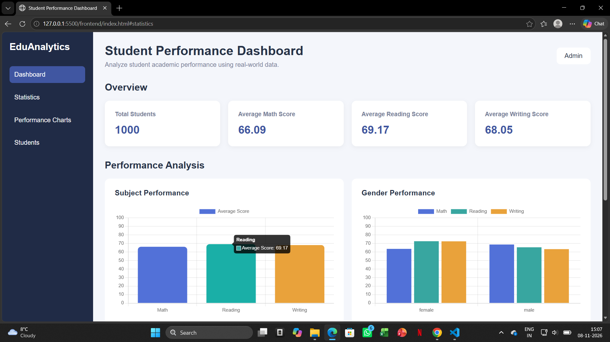
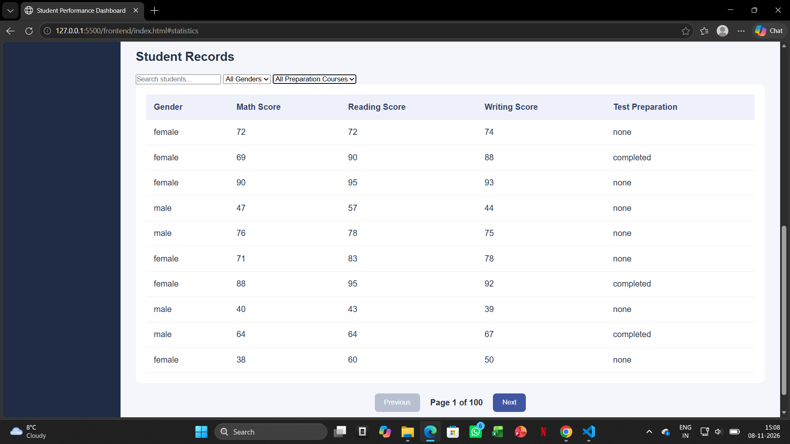
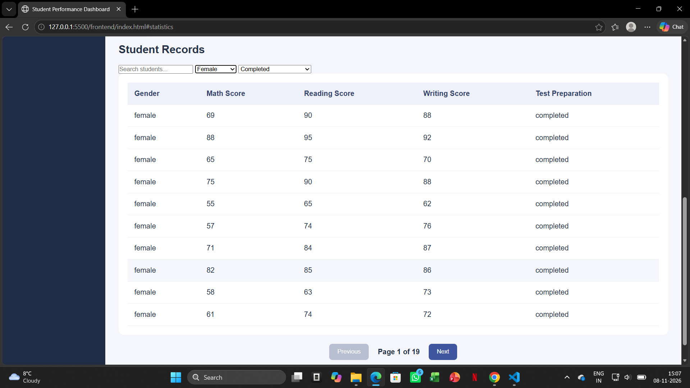

# 🎓 Student Dashboard

An interactive web-based Student Dashboard built using **HTML, CSS, JavaScript, Python and Flask**.

## 📌 About the Project

The Student Dashboard is designed to make student data easier to explore, analyze and manage through a simple and interactive interface.

The objective of this project was to build a practical application using fundamental web technologies while understanding how frontend and backend systems communicate.

**Simple technology. Powerful functionality. Practical implementation.**

## ✨ Features

- 📊 Dashboard statistics and data visualization
- 👨‍🎓 Interactive student records table
- 🔍 Student search functionality
- ⚧️ Gender-based filtering
- 📚 Preparation course filtering
- 📄 Pagination with Next and Previous navigation
- 🔄 Dynamic pagination based on filtered results
- 🔗 Frontend and backend integration through Flask APIs

## 🛠️ Technologies Used

| Technology | Purpose |
|---|---|
| HTML5 | Structure of the dashboard |
| CSS3 | Styling and layout |
| JavaScript | Interactivity and dynamic functionality |
| Python | Backend programming |
| Flask | REST API development |
| Fetch API | Frontend-backend communication |
| JSON | Data exchange |

## 🏗️ Application Architecture

The application follows a simple frontend-backend architecture.

- **Frontend:** Displays student information and handles user interactions.
- **Backend:** Processes requests and provides student data through Flask APIs.
- **Communication:** JavaScript Fetch API sends HTTP requests and receives JSON responses.

## 📂 Project Structure

```text
Student-Dashboard/
│
├── backend/
│
├── frontend/
│
└── README.md
```

## 🎯 Key Learning Outcomes

Through this project, I gained practical experience in:

- Frontend and backend integration.
- Developing and consuming REST APIs.
- JavaScript DOM manipulation.
- Implementing search and filtering functionality.
- Building pagination logic.
- Handling filtered datasets and dynamic page counts.
- Understanding how different web technologies work together.

## 🚀 Future Enhancements

- Student record sorting.
- Additional analytical visualizations.
- Improved responsive design.
- More advanced filtering capabilities.

## 👨‍💻 Author

Developed as part of my Computer Science learning journey.

**Technologies:** HTML | CSS | JavaScript | Python | Flask


## 📸 Project Screenshots

### 1. Dashboard Overview


### 2. Student Records


### 3. Search, Filtering and Pagination


